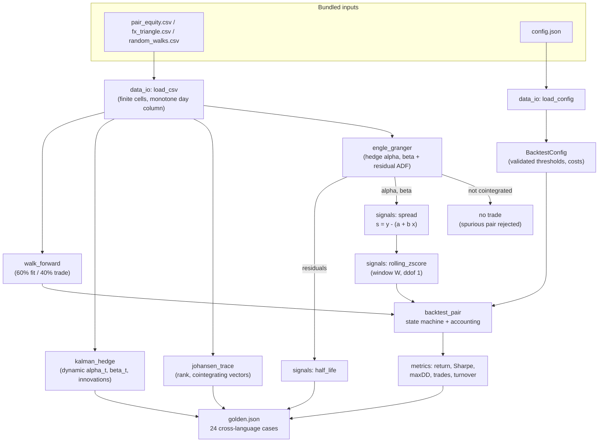
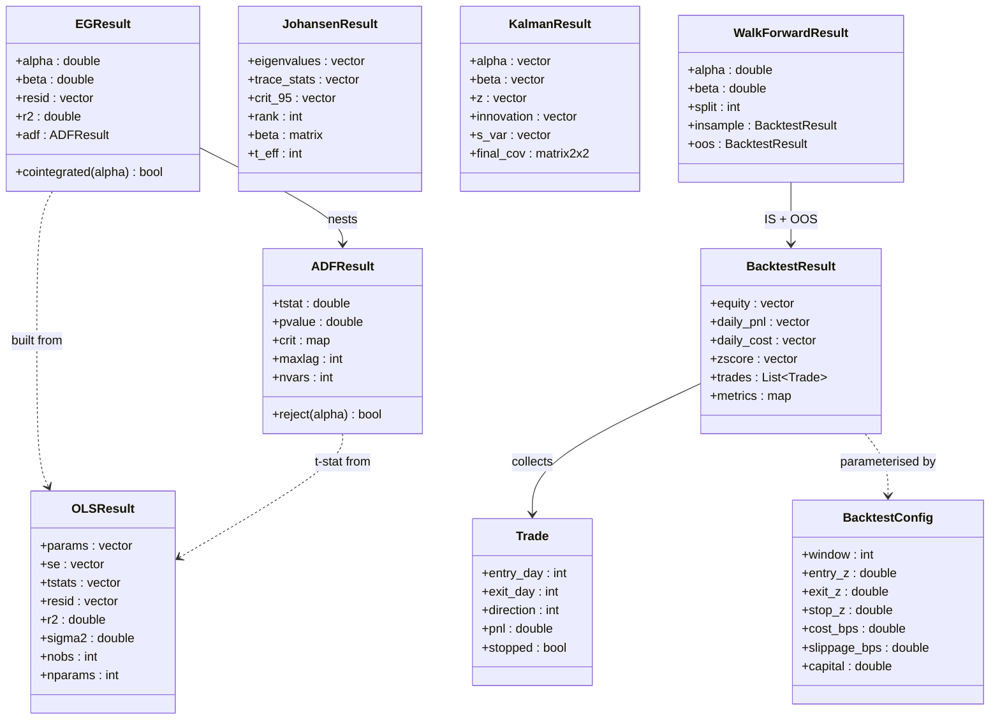
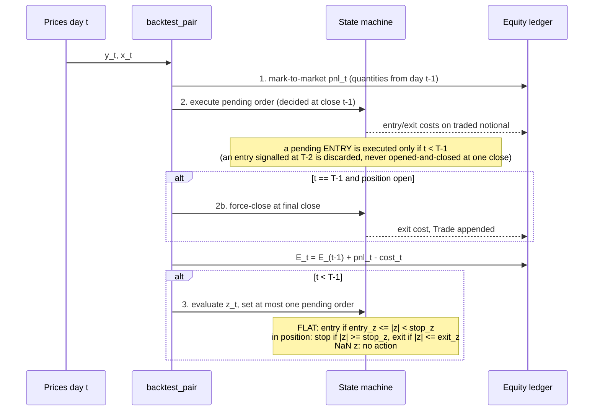

# ARCHITECTURE — statarb

Design notes for the four parallel implementations (Python reference, C++,
Rust, Java) of the statistical-arbitrage toolkit. The single source of truth
for every algorithm is [`../API_SPEC.md`](../API_SPEC.md); this document
explains how the code is organised, why the numerical choices were made, and
how correctness is enforced across languages.

## 1. Component responsibilities

| Component (Python module) | Responsibility | Depends on |
|---|---|---|
| `ols` | Normal-equations OLS: params, plain SEs, t-stats, residuals, R², condition guard | — |
| `adf` | ADF regression builder, embedded MacKinnon (2010) response surfaces (nvars 1/2/3) evaluated at T_eff, interpolated p-value, `reject` verdict | `ols` |
| `signals` | Spread construction, rolling z-score (inclusive window, ddof 1, zero-variance guard), half-life | `ols` |
| `engle_granger` | Two-step test: hedge OLS + residual ADF against the nvars=2/3 table | `ols`, `adf` |
| `johansen` | VECM trace test: partialling-out, product moments, native Cholesky, native cyclic Jacobi eigensolver, Osterwald–Lenum table, rank estimate | — (self-contained linear algebra) |
| `kalman` | (αₜ, βₜ) random-walk filter, Joseph-form update, innovation z-scores | — |
| `backtest` | `BacktestConfig` validation, FLAT/LONG/SHORT state machine, cost accounting, pinned metrics, walk-forward split | `ols`, `signals` |
| `data_io` | Minimal CSV/JSON loaders with validation: finite cells, no ragged rows, unique headers, strictly increasing `day` column (keeps the package numpy-only / dependency-light) | — |

The dependency graph is a shallow DAG — everything statistical funnels
through `ols`, and `johansen` deliberately stands alone with its own tiny
linear-algebra kernel (Cholesky + Jacobi) so that no library eigensolver can
introduce cross-language drift.

## 2. Data flow

Two properties of this flow are load-bearing:

- **The cointegration gate.** `backtest_pair` is only reached with hedge
  parameters that came from a passing Engle–Granger (or Johansen) verdict;
  the spurious random-walk pair is diagnosed and never traded. The demo
  encodes this discipline explicitly.
- **The walk-forward split.** `walk_forward` re-enters the same
  `backtest_pair` twice with one frozen (α, β); the out-of-sample z-score
  warms up inside its own segment, so no statistic computed after the split
  uses pre-split data. The split index is `floor(T·frac + 1e-9)` so that
  binary-float products (`700 × 0.7 = 489.99999999999994`) cannot move it.

## 3. Core types and call structure

Each language expresses these as its idiomatic equivalent: frozen dataclasses
(Python), plain structs (C++/Rust), records/immutable classes (Java). Field
names and semantics are identical everywhere; only casing follows local
convention.

## 4. The backtest day loop (pinned event order)

The trickiest contract in the project is the per-day sequence — it encodes
"signal at close t, execute at close t+1" with zero look-ahead:

Mark-to-market strictly precedes execution, so a fill never earns same-day
P&L; the signal step runs last and only writes a *pending* order. A pending
entry on the final day is discarded rather than executed and force-closed
at the same close (which would report a phantom zero-holding round trip that
paid two costs — the bug class a rolling daily re-run would otherwise hit
every day). Any reordering changes the golden trade count (31) and every
downstream metric — which is exactly why the order is pinned, golden-tested,
and property-tested over every truncation of the bundled pair.

## 5. Numerical design decisions and trade-offs

**Normal equations, not QR/SVD (OLS).** Design matrices here have k ≤ 4
columns, and the golden tolerances (1e−10 on coefficients) require every
language's rounding error to stay well inside that band. LU on X'X is
trivially portable (a 4×4 solve); QR pivoting orders and Householder sign
conventions differ across libraries. Cost: X'X squares the condition number
— mitigated by the pinned cond ≤ 1e12 guard that converts near-collinearity
into a clean error. Trade-off accepted: this OLS is not suitable for large
ill-conditioned designs, and says so.

**Accumulation strategy differs per port; agreement is by tolerance, not by
identical rounding.** The 1500-term cross products are summed by numpy/BLAS
pairwise-style accumulation (Python), Neumaier compensated summation (C++
and Rust) and Kahan compensated summation (Java). All three compensated
schemes are accurate to a few ulps of the exact sum, so the four ports agree
within the golden tolerances (1e−6 … 1e−10) *despite* different rounding
sequences; nothing here relies on bit-identical arithmetic. The C++ port
deliberately avoids `long double`, whose width is 80 bits on x86 gcc/clang,
64 bits (plain double) on MSVC and 128-bit software arithmetic on AArch64 —
a portability trap for tolerance-based golden tests.

**Fixed ADF lag, MacKinnon (2010) response-surface critical values,
interpolated p-value.** Automatic lag selection (AIC/BIC) would make the
test statistic depend on a selector implementation. Critical values are the
published finite-sample response surfaces `b_inf + b1/T + b2/T² + b3/T³`
(nine rows × four coefficients, embedded verbatim, evaluated in Horner
form at the regression's own T_eff) — the same numbers statsmodels'
`mackinnoncrit` uses, cross-validated against it by `generate_data.py`. The
surfaces were fitted on samples of 20 and more, so `T_eff < 20` is refused
instead of extrapolated. The p-value remains a documented three-knot
piecewise-linear approximation clamped to [1e−4, 0.9999]; the *verdict*
never touches it (direct comparison with the finite-sample value).

**Native Cholesky + cyclic Jacobi for Johansen.** The canonical-correlation
eigenproblem is solved in symmetric form via `A = L⁻¹ S₁₀S₀₀⁻¹S₀₁ L⁻ᵀ`.
Library eigensolvers (LAPACK, Eigen, ndarray, java built-ins) differ in
algorithm, sweep order, and eigenvector signs; a hand-rolled cyclic Jacobi
with a pinned rotation formula, sweep order, tolerance (1e−14) and sweep cap
(100) produces identical eigenvalues everywhere. On 2×2/3×3 symmetric PSD
matrices Jacobi converges quadratically in a handful of sweeps; hitting the
sweep cap is defined as non-fatal (best iterate returned) because it cannot
occur for these sizes. Eigenvalues are clipped to [0, 1−1e−12] before
`ln(1−λ)` so the trace statistic can never produce −inf.

**Joseph-form Kalman update.** `(I−KH)P` can lose symmetry/PSD-ness under
rounding; Joseph form `(I−KH)P(I−KH)' + rKK'` is PSD by construction, and
an explicit `P := (P+P')/2` symmetrisation removes residual asymmetry bits.
For a 2×2 state the extra flops are negligible and the payoff is 1e−8
cross-language agreement over 1500 filtering steps. The prior (s₀ = 0,
P₀ = 1e3·I) is pinned because the first ~50 filtered betas depend on it.

**Equal-dollar sizing, β in the signal only.** Sizing legs by the hedge
ratio couples position risk to an estimated quantity and breaks exact
dollar-neutrality; the pinned design puts capital/2 on each leg (exactly
neutral at entry, testable) and lets β act where it belongs — in the spread
that generates the z-score.

**Undefined metrics are pinned, not left to IEEE.** `ann_return =
(1+total)^(252/N) − 1` has no real value once equity is ≤ 0; every port pins
it to exactly −1 in that case (max drawdown then exceeds 1 but stays
finite). Every metric is asserted finite on a synthetic total-loss fixture.

**Determinism.** No RNG at runtime anywhere; randomness exists only in
`data/generate_data.py` with fixed seeds (42, 7, 100). All iteration orders,
tolerances, and tie-breaks are pinned. Any two runs of any implementation
produce byte-identical metrics.

## 6. Error-handling strategy

One validation contract (API_SPEC §9), four idiomatic surfaces:

| Language | Mechanism | Example |
|---|---|---|
| Python | `raise ValueError("...")` | `"window (61) larger than series length (60)"` |
| C++ | `throw std::invalid_argument` | same message text |
| Rust | `Result<T, StatarbError>` (hand-written enum: `LengthMismatch`, `NonFinite`, `ConstantSeries`, `Singular`, `TooShort`, `InvalidParam`, `Data`; no panic on bad input) | `Err(StatarbError::InvalidParam("window (61) larger than series length (60)"))` |
| Java | `throw IllegalArgumentException` | same message text |

Design rules:

- **Validate at the boundary, then trust.** Every public entry point checks
  lengths, emptiness, finiteness, domains (δ ∈ (0,1), r finite and > 0,
  0 ≤ maxlag ≤ 1000, nvars ∈ {1,2,3}, finite thresholds and costs plus
  their ordering) before any arithmetic; internal helpers assume clean
  inputs. Domain checks are written as *negated* comparisons
  (`!(r > 0.0 && isfinite(r))`) so that NaN — which compares false to
  everything — cannot slip through a `<= 0` test. Ports with mutable config
  structs (C++, Rust) re-run the validation inside `backtest_pair` /
  `walk_forward`. The CSV loader is a boundary too: non-finite cells and a
  non-monotone `day` column are refused before any model sees them.
- **Errors for misuse, guarded values for in-domain degeneracy.** A constant
  series into ADF is an *error*; a zero-variance z-score window is *NaN*
  (no signal); ρ ≥ 0 in half-life is *+inf* (no reversion). The line: if
  the caller could not have known in advance, return a defined sentinel;
  if the input violates the contract, refuse loudly.
- **No silent NaN propagation.** NaN appears only where the spec defines it
  (z-score warm-up and zero-variance windows) and the backtest state machine
  treats it as "no action" explicitly. A NaN parameter (cost, threshold,
  Kalman `r`) is an error at construction, never a NaN equity curve with a
  plausible-looking Sharpe of 0.0.
- **Typed errors even for degenerate shapes.** Empty arrays raise the
  language's validation error (never `ArrayIndexOutOfBounds` / UB / a Rust
  panic); `walk_forward` checks lengths before slicing; `maxlag` is bounded
  and computed in 64-bit so no signed overflow is reachable.
- **Non-convergence policy.** The Jacobi sweep cap is the only iterative
  loop; hitting it returns the best iterate (documented, cannot happen at
  n ≤ 3) rather than throwing — matching the "report, don't crash"
  convention for calibration-type code.

## 7. Testing strategy

Four layers, mirrored in every language:

1. **Golden values** (`data/golden/golden.json`, exactly 24 cases — each
   suite asserts the count): end-to-end scalars — OLS coefficients, ADF
   t-stats with their finite-sample 5% critical values and an interpolated
   p-value, EG/Johansen verdicts and trace stats, half-life, Kalman betas at
   pinned days, z-scores at pinned days, backtest metrics with an exact
   integer trade count. Tolerances 1e−6 to 1e−10. This is the
   cross-language contract-enforcement layer; the values are written by
   `generate_data.py` only after the Python reference passes a statsmodels
   cross-check of OLS (coefficients, SEs), ADF (t-stat and `mackinnoncrit`
   critical values) and Johansen (`coint_johansen` plus an independent numpy
   generalised-eigen solve).
2. **Analytic identities**: OLS vs the closed-form two-variable solution;
   the backtest accounting identity `E_end − capital = Σpnl − Σcost` at
   1e−10; exact dollar-neutrality at entry; Joseph-form P kept PSD (2×2
   closed-form eigenvalues on the final posterior); Johansen eigenvalue
   ordering λ₁ ≥ λ₂ ≥ 0; the MacKinnon surface hand-evaluated at T = 20,
   50, 898 and 1498.
3. **Synthetic-spread fixtures with derived expectations** (all four
   ports): a single spike on a zero background has the closed-form z-score
   `(W−1)/√W` (and `−1/√W` the next day), which pins the stop-band-while-flat
   rule; small sinusoidal backgrounds with plateaus pin the entry → stop →
   exit timing (`exit_day == t_stop + 1`, cost equals bps × recomputed exit
   notional), same-direction re-entry with no cool-down, the end-of-data
   discard rule, walk-forward split exactness (700 × 0.7 → 490), and the
   negative-equity metrics (total return −1.5 exactly, annualised −1,
   drawdown 1.5, finite Sharpe). Each fixture recomputes the z-path with an
   independent rolling mean/std before asserting the backtest's trades.
4. **Property checks**: every truncation of the bundled pair (T = 70 … 1500)
   yields only trades with `exit_day > entry_day`; the p-value is monotone
   in t; z-score warm-up length equals W−1 for a grid of windows; noiseless
   linear data is recovered exactly over a coefficient grid.
5. **Behavioural/statistical checks**: ADF strongly rejects on bundled
   white noise, fails to reject on the bundled random walk; Kalman with
   δ → 0 converges to static OLS β within a loose band; stop-losses fire in
   the break regime; walk-forward OOS degradation present.
6. **Error paths**: every §6 validation raises its language's error type
   with the specified conditions — NaN/inf parameters, empty arrays, length
   mismatches in `walk_forward`, mutated C++/Rust configs, collinear
   Johansen levels, non-finite matrices in the eigensolver, bad CSV/config
   content — plus the C++ test that previously skipped zero-day trades now
   asserts they never occur.

Python additionally cross-checks OLS, ADF critical values and Johansen
against statsmodels — in tests and `generate_data.py` only; the shipped
package depends on numpy alone. Counts at this release: Python 86, C++ 63,
Rust 74, Java 65 tests, all passing.

## 8. Performance notes

The workloads are small (T = 1500, n ≤ 3, k ≤ 4), so clarity beats
micro-optimisation everywhere; still, the shapes are worth recording:

- `ols`, `adf_test`, `engle_granger`, `half_life`: O(T·k²) — microseconds.
- `johansen_trace`: O(T·n²) for moments + O(n³) per Jacobi sweep; converges
  in ≤ ~10 sweeps on 3×3.
- `kalman_hedge`: strictly O(T) with constant 2×2 algebra per step;
  1500 steps in well under a millisecond in the native languages. The
  Python loop is interpreter-bound (~ms) — acceptable for a reference.
- `rolling_zscore`: O(T·W) as written (recomputing each window). A rolling
  sum/sum-of-squares O(T) variant was rejected deliberately: subtracting
  running sums accumulates cancellation error and would break the 1e−10
  golden z-scores across languages. At T·W ≈ 90k multiply-adds the naive
  loop is instantaneous.
- `backtest_pair`: single O(T) pass; the dominant cost is the z-score.

Memory: everything is O(T) vectors; the largest allocation is the handful of
1500-length paths in the backtest result. No parallelism is used or needed;
determinism would forbid reduction reordering anyway.
